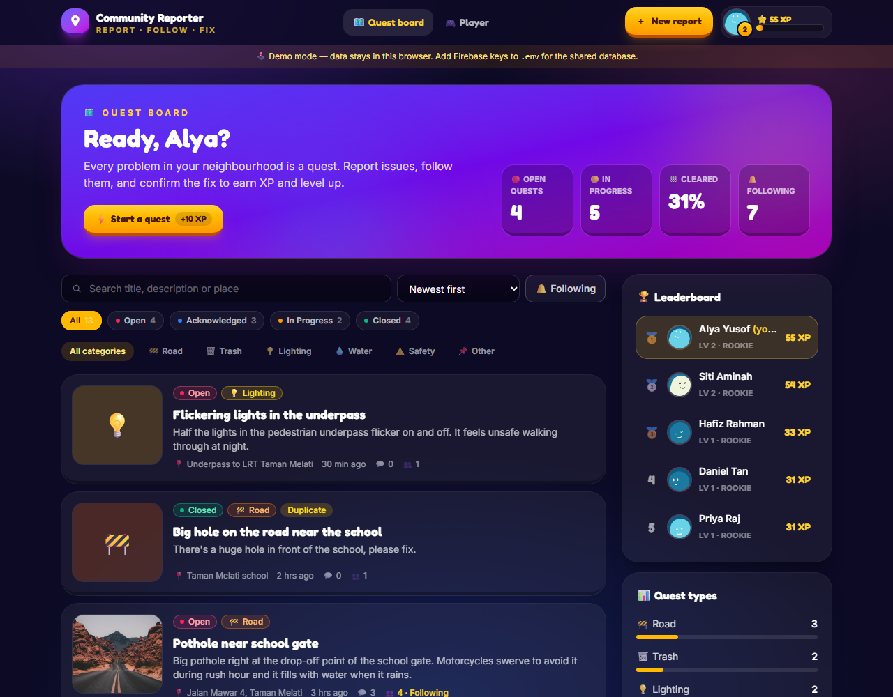
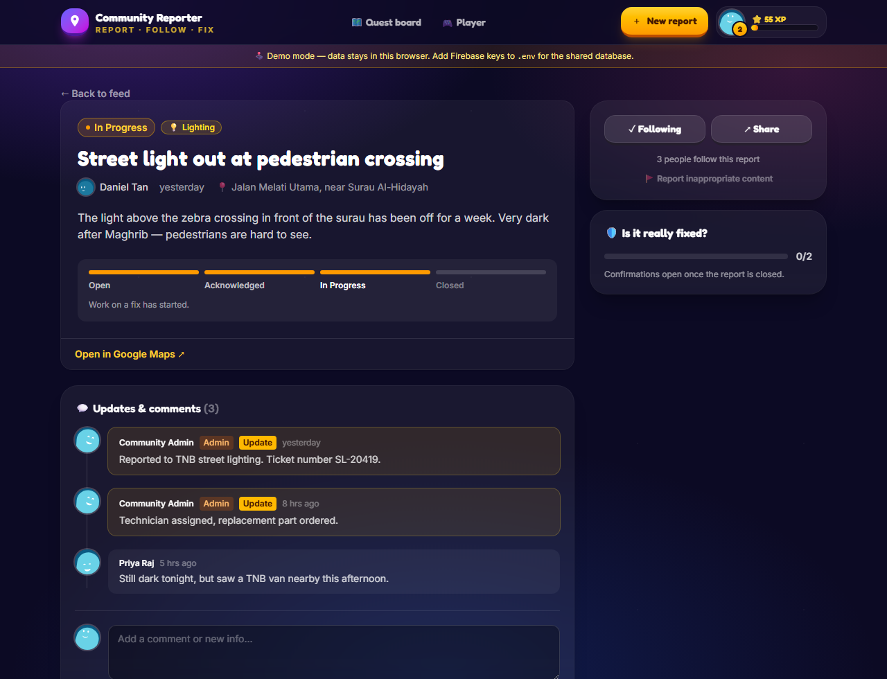
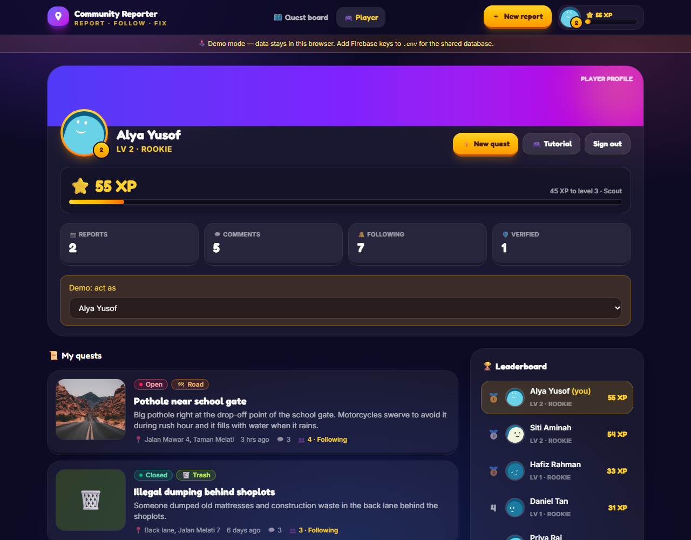
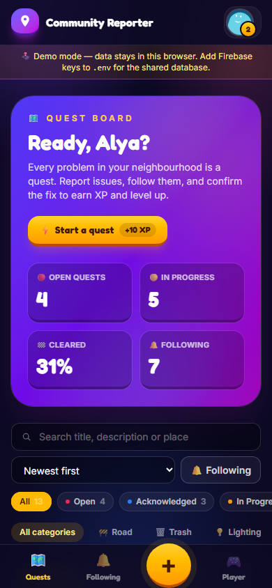
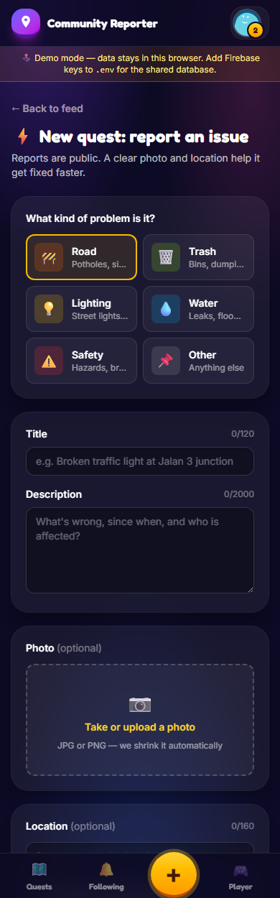
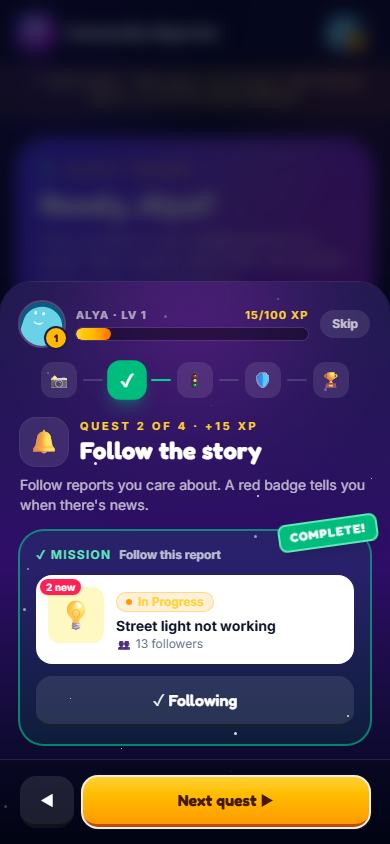
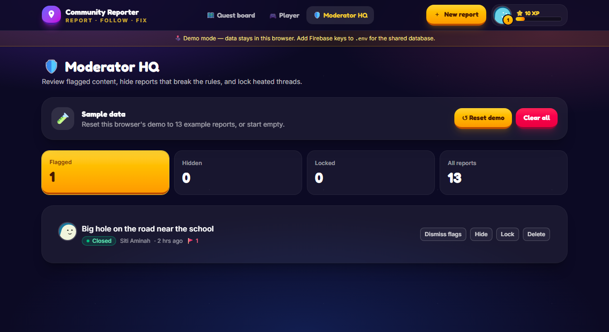

# 🗺️ Community Reporter

**Spot it. Report it. Fix it.** A game-themed Progressive Web App where residents report local problems (potholes, broken street lights, overflowing bins), follow them until they're fixed, and confirm the fix is real. Earning XP and levelling up keeps neighbours coming back.

Built with **React 19 + TypeScript + Tailwind CSS v4 + Firebase** (Google sign-in and real-time Cloud Firestore). Without Firebase keys it runs as a fully working **demo mode** with sample data.



---

## 📸 Screenshots

| Report page | Player profile |
|---|---|
|  |  |

**On mobile** — installable PWA with a bottom tab bar and a big ＋ button:

<p>
  
  &nbsp;
  
  &nbsp;
  
</p>

| Game-style tutorial (first sign-in) | Moderator HQ |
|---|---|
|  |  |

---

## ✨ Features

### Report & track
- **Report an issue** with a category picker, title, description, **photo upload** (from camera or gallery, compressed in the browser, no Firebase Storage needed) and **GPS location** with an embedded map.
- **Status flow:** 🔴 Open → 🔵 Acknowledged → 🟡 In Progress → 🟢 Closed, shown as a progress bar.
- **Confirm the fix:** neighbours (not the reporter) verify a closed report is really fixed. Two confirmations mark it as resolved.
- **Edit or delete** your own reports. **Share** any report with a link.

### Quest board (feed)
- Search, status and category filters, and sorting (newest, recently active, most followed).
- **Follow** reports. The 🔔 Following view shows a red **"N new"** badge when someone posts an update you haven't seen.
- Comments show the author's name, avatar and an *Admin* or *Reporter* tag. Only the reporter and admins can post official **progress updates**.

### Game layer 🎮
- **XP and levels:** report +10, comment +2, confirm a fix +5, your fix confirmed +20. Every 50 XP is a new level (Rookie → Scout → Hero → Guardian → Legend).
- **Player HUD** in the top bar, **"+XP" pop-ups** and **LEVEL UP** banners.
- **🏆 Leaderboard** and **🎖️ achievements** with progress (First Report, Helper, Resolver).
- **Onboarding tutorial:** four interactive quests on first sign-in. Replay it from the Player page.

### Moderation 🛡️
- Anyone can flag a report. **Moderator HQ** has Flagged, Hidden, Locked and All tabs.
- Admins can hide reports, lock comments, dismiss flags, mark duplicates (linked to the original) and delete.

### PWA
- Installable (manifest and app icons) and mobile-first, with an offline app shell. Pages are fetched from the network first, so new deploys show up right away.

---

## 🚀 Quick start (demo mode)

```bash
cd community-reporter
npm install
npm run dev
```

Open <http://localhost:5173>. With no `.env`, the app runs in **demo mode**: 13 sample reports, 7 neighbours and comments, all saved in your browser. On the **Player** page you can switch between demo users, including an admin.

---

## 🔥 Firebase setup

1. Create a project at <https://console.firebase.google.com>.
2. **Authentication → Sign-in method** → enable **Google**.
3. **Firestore Database** → create a database (production mode).
4. **Project settings → Your apps** → add a **Web app** and copy its config into `community-reporter/.env`:
   ```bash
   cp .env.example .env   # then fill in the VITE_FIREBASE_* values
   ```
5. Deploy the security rules (once, and whenever `firestore.rules` changes):
   ```bash
   npm install -g firebase-tools
   firebase login
   firebase use --add            # pick your project, alias "default"
   firebase deploy --only firestore:rules
   ```
6. Restart `npm run dev` and sign in with Google.

### Make someone an admin
After a user signs in once, open **Firestore → `users/{uid}`** in the console and change `role` from `member` to `admin`. They then sign out and back in. Users can't change their own role; the rules enforce this.

### Deploy to Firebase Hosting
```bash
npm run build
firebase deploy --only hosting
```
Your app is live at `https://<project-id>.web.app`. After each deploy, do one hard refresh (Ctrl+Shift+R).

---

## 🧪 Sample data

| Where | How |
|---|---|
| **Demo mode** | Loaded automatically. **Moderator HQ → Reset demo / Clear all**. |
| **Firebase, as admin** | Click **🧪 Load sample data** on the empty feed or in Moderator HQ. Reports are posted as you. |
| **Firebase, multiple accounts** | `npm run seed` creates 7 neighbour accounts, each posting their own reports, comments, follows and confirmations. |

To use `npm run seed`:
1. **Authentication → Sign-in method** → enable **Email/Password**.
2. Add `SEED_PASSWORD=<8+ characters>` to `.env`. It is used for every sample account.
3. Deploy the latest rules, then run `npm run seed`. To seed again, use `npm run seed -- --force`.

All sample content is tagged **🧪 Sample**. **Moderator HQ → Remove sample data** deletes it. The sample accounts stay under *Authentication → Users*; delete them there if you want them gone. The content itself lives in [`src/data/sampleData.ts`](community-reporter/src/data/sampleData.ts).

---

## 🛠️ Scripts

| Command | What it does |
|---|---|
| `npm run dev` | Start the dev server |
| `npm run build` | Type-check and build to `dist/` |
| `npm run preview` | Serve the production build locally |
| `npm run lint` | Run ESLint |
| `npm run seed` | Seed Firestore with sample accounts and data |

---

## 📁 Project structure

```
community-reporter/
├── firestore.rules          # Security rules (validation, roles, privacy)
├── firebase.json            # Rules + Hosting config
├── scripts/seed-firebase.ts # npm run seed
├── public/                  # Manifest, icons, service worker
└── src/
    ├── components/          # Layout, Navbar, ReportCard, Leaderboard, OnboardingTour, RewardToasts, ui
    ├── pages/               # Feed, NewReport (create/edit), ReportDetail, Profile, Admin
    ├── state/               # AppState API + Firebase and local (demo) providers
    ├── lib/                 # Firebase init, image compression, formatting, styles
    └── data/                # Types, demo users, sample dataset
```

---

## 🗄️ Data model

| Collection | Fields | Notes |
|---|---|---|
| `users/{uid}` | `name`, `avatar`, `role`, `onboardedAt?` | Created on first sign-in. Public read. |
| `reports/{id}` | `title`, `description`, `category`, `status`, `location?`, `coords?`, `photoUrl?` (compressed data URL), `followers[]`, `flaggedBy[]`, `resolutionConfirmations[]`, `hidden`, `commentsLocked`, `duplicateOf?`, `createdAt`, `createdAtMs`, `updatedAtMs?`, `sample?` | Hidden reports are readable only by admins and the reporter. |
| `updates/{id}` | `reportId`, `userId`, `text`, `type` (`comment` or `update`), `createdAt`, `createdAtMs`, `sample?` | Blocked when comments are locked (except for admins). |

**Security rules highlights:** report fields are validated (lengths, categories, photo size). Users can only follow, flag or confirm as themselves. The reporter can't confirm their own fix. Only the reporter or an admin can edit or delete a report or post an official update. Roles can only be changed from the console.

---

## 🧰 Tech stack

React 19 · TypeScript · Vite (rolldown) · Tailwind CSS v4 · React Router 7 · Firebase Auth · Cloud Firestore (offline cache) · Firebase Hosting · OpenStreetMap embeds
